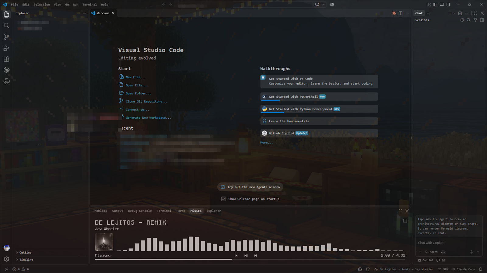
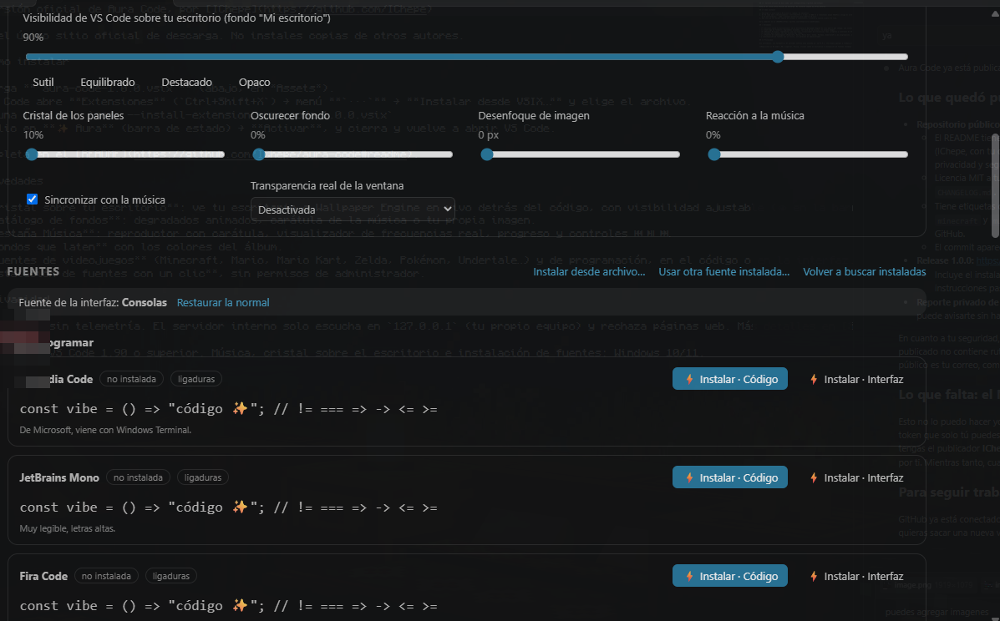
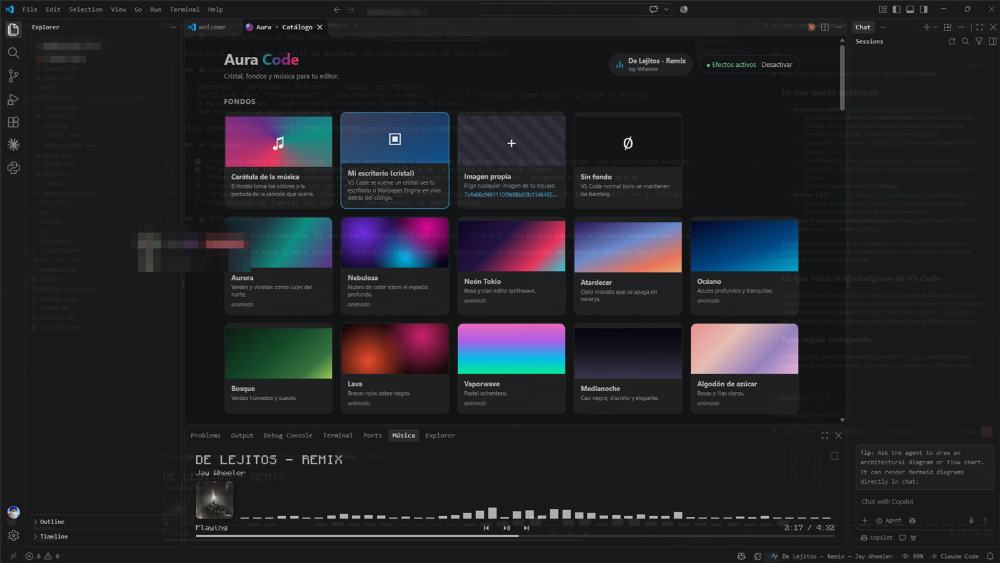
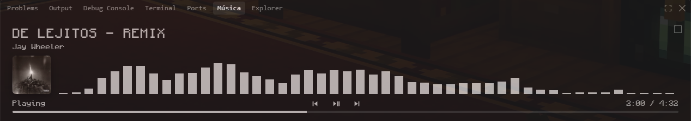
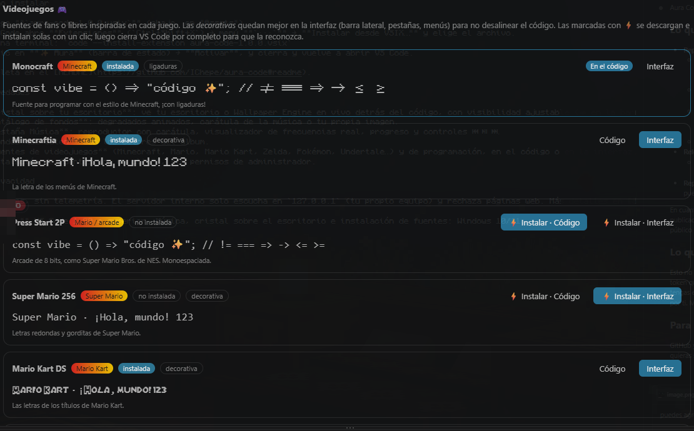

<h1 align="center">✨ Aura Code — Visual Studio Code Theme Changer 🎨</h1>

<p align="center">
  <b>Completely transform VS Code: glass mode over your desktop, animated backgrounds, video game fonts and a music player that beats with your songs.</b>
</p>

<p align="center">
  <a href="https://github.com/IChepe/aura-code/releases/latest"></a>
  <a href="LICENSE"></a>
  
  
</p>

<p align="center"><b>🇬🇧 English</b> · <a href="README.es.md">🇪🇸 Español</a></p>

> 🆓 **100% free and open source.** No payments, no accounts, no ads. Made by [**IChepe**](https://github.com/IChepe).

Aura Code is an open-source extension that completely changes how Visual Studio Code looks:

- 🪟 **Glass over your desktop**: VS Code turns translucent and you see your desktop — or your animated **Wallpaper Engine** background — live behind your code. You decide how much VS Code stands out.
- 🎨 **Background catalog**: animated gradients (Aurora, Nebula, Neon Tokyo, Lava…), the cover art of the song playing, or any image of yours, with glass panels.
- 🎵 **Music tab**: a player next to *Problems / Output / Terminal* with title, artist, cover art, a **real frequency visualizer**, progress and ⏮ ⏯ ⏭ controls. Works with Spotify, YouTube in the browser and any app that shows its music in Windows.
- 💓 **Backgrounds that beat with the music**: the background takes the album colors and pulses to the rhythm.
- 🔤 **Coding font catalog**: Cascadia Code, JetBrains Mono, Fira Code, Monaspace, Victor Mono, Maple Mono and more.
- 🎮 **Video game fonts**: Minecraft (Monocraft, Minecraftia), Super Mario, Mario Kart, Zelda, Pokémon, Undertale, arcade and retro. Use them in the code or in the interface (sidebar, tabs, menus).
- ⚡ **One-click font installs** (Windows): Aura downloads them from their public source, installs them just for your user and tells you when they're ready. No admin rights needed.
- 🌍 **English and Spanish**: pick the language in the catalog or let it follow VS Code.
- 🔔 **One-click updates**: Aura lets you know when a new version is out and installs it for you.


<sub>*VS Code in **glass mode** over a Wallpaper Engine background (Minecraft style), with the Monocraft font and the **Music** tab playing. Screenshots show the Spanish interface.*</sub>

---

## 📸 Feature tour

### 🪟 Glass mode: your live desktop behind your code

Glass mode turns the whole VS Code window into glass: you see your desktop — including **animated Wallpaper Engine backgrounds**, which keep moving — with your code on top.

**How to turn it on**

1. Open the catalog (**✨ Aura** in the status bar).
2. Under **Backgrounds** choose **My desktop (glass)**.
3. Done: it applies instantly, no restart.

**How to tune it**

The status bar shows **👁 92%**: that's how much VS Code *stands out* over your desktop. Click it and pick a level:

| Level | What you'll see |
| --- | --- |
| **100% Opaque** | Regular VS Code, no transparency |
| **95% Prominent** | The code stands out; the desktop is just a hint |
| **90% Very visible** | Great balance for long coding sessions |
| **85% Balanced** | Code and desktop in equal parts |
| **78% Translucent** | The desktop takes more of the spotlight |
| **70% Subtle** | Perfect to show off an animated background |
| **55% Ghost** | Just for showing off 😎 |

You can also use the **VS Code visibility over your desktop** slider in the catalog (with *Subtle / Balanced / Prominent / Opaque* quick buttons) or the **Aura: Make VS Code more visible / more transparent** commands, which you can bind to a keyboard shortcut.



**Good to know**

- Glass mode is **only** active with the *My desktop* background. If you pick any other background, the window becomes opaque again automatically.
- Windows applies the same transparency to the **whole** window, text included. If it's hard to read, raise the visibility.
- You see **everything** behind VS Code (other open windows too). To see only your wallpaper, maximize VS Code.
- It doesn't modify VS Code files: it's a Windows feature, so it turns on and off instantly.
- Difference from the other backgrounds: with *Aurora*, *Album cover*, *Custom image*, etc. Aura **draws** the background inside VS Code and makes the panels translucent (**Panel glass**); with *My desktop*, Windows lets you see what's **behind** the window.

### 🎨 Background catalog

Choose between special backgrounds and gradients (the ones marked *animated* move slowly):

- **Album cover**: the background is tinted with the colors of the album playing and beats to the rhythm.
- **My desktop (glass)**: the glass mode explained above.
- **Custom image**: any photo or GIF on your PC, with adjustable blur and dimming.
- **No background**: regular VS Code (keeps your fonts).
- **Gradients**: Aurora, Nebula, Neon Tokyo, Sunset, Ocean, Forest, Lava, Vaporwave, Midnight and Cotton candy.



### 🎵 Music tab

A new tab in the bottom panel, next to *Problems*, *Output* and *Terminal*:

- Song title and artist, album cover and status (*Playing / Paused*).
- **Real frequency visualizer**: Aura captures the audio playing on your PC and splits it into 48 bands (bass → treble); it's not a canned animation.
- Progress bar with time, and **⏮ ⏯ ⏭** buttons that control Spotify, YouTube, etc.
- **Transparent** style (with the cover colors) or black-and-white **retro** style: switch with the little square in the corner.



### 🎮 Video game and coding fonts

- Click **⚡ Install · Code** or **⚡ Install · Interface**: Aura downloads the font, installs it and applies it. Then close and reopen VS Code.
- **Code** changes the editor font; **Interface** changes the sidebar, tabs and menus. You can mix them (for example Minecraftia in the menus and Monocraft in the code).
- *Decorative* fonts (Mario, Zelda, Pokémon…) have letters of different widths: they look best in the interface.
- Got another font? Use **Install from file…** or **Use another installed font…**.



---

## 📦 Installation

### Option 1 — From the VS Code Marketplace (recommended)

1. In VS Code open **Extensions** (`Ctrl+Shift+X`).
2. Search for **Aura Code** and check that the publisher is **IChepe**.
3. Click **Install**.

> If it isn't on the Marketplace yet, use option 2.

### Option 2 — Download the installer (`.vsix`) from GitHub

1. Go to the [**Releases**](https://github.com/IChepe/aura-code/releases) page and download the latest `aura-code-X.Y.Z.vsix` file.
2. In VS Code open **Extensions** (`Ctrl+Shift+X`) → **`···`** menu → **Install from VSIX…** and pick the file.

   Or from a terminal:

   ```bash
   code --install-extension aura-code-1.1.0.vsix
   ```

### Option 3 — Build it yourself from source

Requirements: [Node.js](https://nodejs.org) 18 or later and [Git](https://git-scm.com).

```bash
git clone https://github.com/IChepe/aura-code.git
cd aura-code
npm install
npx vsce package
code --install-extension aura-code-1.1.0.vsix
```

---

## 🚀 Getting started

1. After installing, click **✨ Aura** (status bar, bottom right) or run `Ctrl+Shift+P` → **Aura: Open catalog**.
2. Click **Activate**. Aura will ask for permission to modify a VS Code file ([why](#-how-it-works)).
3. **Close VS Code completely** (*File → Exit*) and open it again.
4. Pick a background in the catalog:
   - **My desktop (glass)** → see your desktop / Wallpaper Engine live. Adjust how much VS Code stands out with the **👁 92%** button in the status bar.
   - **Album cover** → the background takes the colors of the song.
   - A **gradient**, a **custom image** or **no background**.
5. Open the **Music** tab in the bottom panel and play your favorite song 🎶.

### 🌍 Language

Aura speaks **English** and **Spanish**. In the catalog, under **Settings → Idioma / Language**, choose *Automatic* (follows the VS Code language), *Español* or *English*. The change applies instantly.

> Command and setting names in VS Code follow the VS Code display language (*Configure Display Language*).

### 🔔 Updates

If you installed Aura from GitHub, it checks once a day for a new version. When there is one, you'll see a notification with **Update**: Aura downloads the installer from the Release, installs it, and you just reload the window. You can also check any time with **Aura: Check for updates**, or turn it off with the `aura.checkForUpdates` setting.

> If you installed it from the Marketplace, VS Code updates it automatically and Aura doesn't check anything.

### Commands

| Command | What it does |
| --- | --- |
| `Aura: Open catalog` | Panel with backgrounds, settings and fonts |
| `Aura: Choose background` / `Aura: Choose font` | Quick pickers |
| `Aura: Show the music player` | Opens the Music tab |
| `Aura: Adjust VS Code visibility over the desktop` | Glass mode opacity |
| `Aura: Make VS Code more visible` / `more transparent` | Steps of 5% (bind them to a shortcut) |
| `Aura: Use a custom image as background…` | Pick an image from your PC |
| `Aura: Install font from file…` | Installs a `.zip`, `.ttf` or `.otf` |
| `Aura: Use another installed font…` | Any font on your PC, in the code or the interface |
| `Aura: Restore the interface font` | Back to the default menu font |
| `Aura: Toggle music sync` | |
| `Aura: Enable effects` / `Aura: Disable and restore VS Code` | Applies or removes the patch |
| `Aura: Check for updates` | Checks GitHub for a new version |

### Main settings

| Setting | Default | Description |
| --- | --- | --- |
| `aura.background` | `aurora` | Background: a gradient, `album`, `wallpaper` (glass), `image` or `none` |
| `aura.windowOpacity` | `0.92` | VS Code visibility over the desktop (*My desktop* background) |
| `aura.glassOpacity` | `0.78` | Panel opacity over backgrounds |
| `aura.backgroundDim` / `aura.backgroundBlur` | `0.35` / `0` | Dim / blur the background |
| `aura.music.enabled` / `aura.music.reactivity` | `true` / `1` | Music sync |
| `aura.uiFont` | | Interface font |
| `aura.fontApplyToTerminal` | `true` | Also apply to the terminal (monospaced fonts only) |
| `aura.transparency` | `off` | `acrylic` / `mica`: Windows 11 material (experimental) |
| `aura.language` | `auto` | Language: `auto`, `es` or `en` |
| `aura.checkForUpdates` | `true` | Notify when a new version is available |
| `aura.debug` | `false` | Saves a local technical report to diagnose problems |

---

## 🔧 How it works

The official extension API **doesn't allow** changing the VS Code background. That's why Aura, like other popular background extensions, adds a small block of code at the end of `workbench.desktop.main.js` (the file that draws the interface).

```
┌────────────────────┐   Local WebSocket    ┌─────────────────────────────┐
│ Extension (Node)   │ ───────────────────▶ │ VS Code window              │
│ · settings         │   127.0.0.1 (this    │ (injected code)             │
│ · images, CSS      │   PC only)           │ · background & glass layer  │
│ · music ───────────┼── PowerShell ───┐    │ · pulse with the music      │
└────────────────────┘                 │    └─────────────────────────────┘
                                       ▼
            Windows Media Controls (title, cover art, controls)
            Core Audio / WASAPI (live volume and spectrum)
```

- **Backups**: before modifying anything, a `*.aura-backup` copy is saved. When you disable or uninstall, VS Code is left **byte-for-byte identical** to the original.
- **Checksums**: Aura updates `product.json` so VS Code doesn't show the *"installation appears to be corrupt"* warning.
- **VS Code updates**: every update removes the patch; Aura detects it and applies it again (it will ask you to restart once).
- **Glass mode (My desktop)**: doesn't modify files; it asks Windows to draw the window with transparency.

> ⚠️ Modifying VS Code files isn't officially supported by Microsoft. If something looks wrong, run **Aura: Disable and restore VS Code**.

---

## 🔒 Privacy and security

- **Nothing leaves your PC.** Aura has no servers, collects no data, and uses no analytics or telemetry.
- **The internal server only listens on `127.0.0.1`** (your own computer's "localhost" address, unreachable from the internet or your network) and **rejects connections from web pages**, so no site can see what music you're listening to or control your player.
- **The only internet connections**, always over HTTPS:
  - when you ask to install a font, to its public source (the open Google Fonts repository, GitHub releases and dafont);
  - once a day, to the public GitHub API to see if a new Aura version exists (no data about you is sent; turn it off with `aura.checkForUpdates`).
- **Fonts in your Downloads folder**: Aura never installs anything without asking you.
- **The code injected into VS Code only draws** (styles and colors); it doesn't run commands or read files.
- The bundled PowerShell scripts (`media/*.ps1`) are readable: you can check exactly what they do.

Found a security issue? Read [SECURITY.md](SECURITY.md).

---

## 🩺 Troubleshooting

<details>
<summary><b>"Error loading webview… Could not register service worker: InvalidStateError"</b></summary>

This is a known VS Code issue with its internal *Service Worker* cache (used by every extension panel, not just Aura's). It usually happens after VS Code updates while open, or when it's run as administrator.

1. Close **all** VS Code windows (*File → Exit*) and open it again. That's often enough.
2. If it persists, close VS Code completely (also end any **Code** process in Task Manager), open **PowerShell** and run:
   ```powershell
   Remove-Item -Recurse -Force "$env:APPDATA\Code\Service Worker"
   ```
   Then open VS Code again. VS Code rebuilds that cache by itself; you won't lose extensions, settings or files. (For VS Code Insiders the folder is `Code - Insiders`.)
3. Don't run VS Code as administrator in everyday use.
</details>

<details>
<summary><b>"Your Code installation appears to be corrupt"</b></summary>

It shows up right after enabling Aura or after a VS Code update, because VS Code keeps the old file list in memory until it fully restarts. Close **all** windows (*File → Exit*) and open VS Code again. If it keeps appearing, run **Aura: Enable effects** once more (it fixes the checksums) and restart.
</details>

<details>
<summary><b>I activated Aura but the background doesn't show</b></summary>

- Reloading the window isn't enough: close VS Code **completely** (*File → Exit*) and open it again.
- If VS Code installed an update while closing, the update removes Aura's patch. Aura detects it and asks you to restart once more: do it.
- With the **My desktop (glass)** background, Aura doesn't draw anything: what you see is whatever is behind the window. Maximize VS Code to see only your wallpaper.
</details>

<details>
<summary><b>I installed a font but it doesn't appear</b></summary>

VS Code only detects new fonts when it starts: close it completely and open it again. If the terminal says *"The terminal only supports monospace fonts"*, you applied a decorative font: use it for the interface instead, or choose a monospaced one (Monocraft, Press Start 2P, VT323…).
</details>

<details>
<summary><b>"Permission denied" / EPERM when activating</b></summary>

VS Code is installed for all users (in `Program Files`). Run VS Code **as administrator once**, activate Aura, then go back to opening it normally.
</details>

<details>
<summary><b>I don't get update notifications</b></summary>

- Version **1.0.0** didn't include them: install the latest `.vsix` from [Releases](https://github.com/IChepe/aura-code/releases/latest) once (Extensions → `···` → *Install from VSIX…*). You don't need to uninstall the old version and your settings are kept.
- Check that `aura.checkForUpdates` is on, or run **Aura: Check for updates**.
- If you installed from the Marketplace, VS Code updates Aura by itself.
</details>

<details>
<summary><b>The Music tab says "Nothing playing"</b></summary>

Music works on Windows 10/11 with apps that show their song in the Windows media controls (Spotify, browsers with YouTube, Apple Music…). Check that **Sync with music** is on in the catalog.
</details>

<details>
<summary><b>The song shows up but the visualizer bars stay flat</b></summary>

- Update to the latest version (**1.1.1** or later): it supports every audio format and, if the spectrum can't be captured, the bars move with the volume instead.
- Aura listens to the **default Windows output device**. If your browser or player sends sound to a different device (for example headphones chosen only inside the app), set that device as default in Windows (*Settings → System → Sound*) or set the app to use the default device.
- Open *View → Output* and pick **Aura Code**: lines starting with `[media] spectrum:` show the captured audio format or the exact error. Include them if you report the problem.
</details>

<details>
<summary><b>I want to undo everything</b></summary>

Run **Aura: Disable and restore VS Code** and restart: VS Code goes back to being byte-for-byte identical to the original.
</details>

## ⚠️ Known limitations

- Music, glass over the desktop and automatic font installs work on **Windows 10/11**. On macOS and Linux, backgrounds, glass panels and the font catalog work.
- In glass mode, Windows applies the same transparency to the whole window (text included): raise the visibility if it's hard to read.
- The **minimap** is drawn opaque.
- Video game fonts are **fan-made or free creations** inspired by each game, not the official typefaces; Aura doesn't bundle them, it only downloads them from their public source.
- After installing a new font you need to close and reopen VS Code to see it.
- If VS Code is installed for all users (in `Program Files`), you may need to run it as administrator once to activate Aura.

## 🗑️ Uninstall

1. Run **Aura: Disable and restore VS Code** and restart VS Code.
2. Uninstall the extension from the Extensions tab.

(If you uninstall without disabling, Aura restores VS Code automatically the next time it restarts.)

---

## 🛠️ Development

```bash
git clone https://github.com/IChepe/aura-code.git
cd aura-code
npm install
npm run compile
```

Open the folder in VS Code and press **F5** (*Probar Aura Code*) to launch a test window.

```
src/
  extension.ts     Activation, commands, status bar, font installs
  hub.ts           Local WebSocket server; coordinates multiple windows
  patchCore.ts     Apply/remove the patch, checksums, backups
  uninstall.ts     Automatic cleanup on uninstall
  media.ts         Reads music from media-watcher.ps1
  musicView.ts     "Music" panel tab
  windowGlass.ts   Glass over the desktop
  catalog.ts       Background and font catalog  ← add yours here!
  catalogPanel.ts  Catalog panel
  i18n.ts          English and Spanish texts
  updater.ts       Update notifications from GitHub
  net.ts           HTTPS downloads
  fonts.ts, fontInstaller.ts   Font detection, download and install
media/
  runtime.js           Code injected into the VS Code window
  aura.css             Glass styles (sent without re-patching)
  media-watcher.ps1    Music: metadata, spectrum and controls (Windows)
  window-opacity.ps1   Window transparency (Windows)
  install-font.ps1     Installs fonts for the current user (Windows)
  catalog.*, player.*  Catalog and player interfaces
package.nls.json, package.nls.es.json   Command and setting names
```

## 🤝 Contributing

Contributions are welcome! Ideas:

- 🎨 More gradients or fonts in `src/catalog.ts`.
- 🐧 Music on Linux (MPRIS / `playerctl`) and macOS.
- 🖼️ Slideshow from an image folder.
- 🌍 More languages (texts live in `src/i18n.ts` and `package.nls.*.json`).

1. Fork the repo and create a branch: `git checkout -b my-improvement`
2. Make your changes and test them with **F5**
3. Open a *Pull Request* explaining what you changed

## 👤 Author

Made by **IChepe** — [github.com/IChepe](https://github.com/IChepe) · jdastorgamo1782@gmail.com

## 📄 License

[MIT](LICENSE) © 2026 IChepe. You're free to use, modify and share Aura Code as long as you keep the copyright notice.
